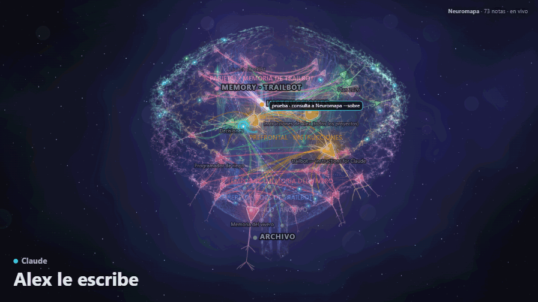
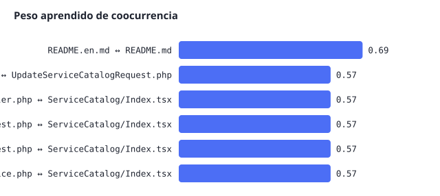
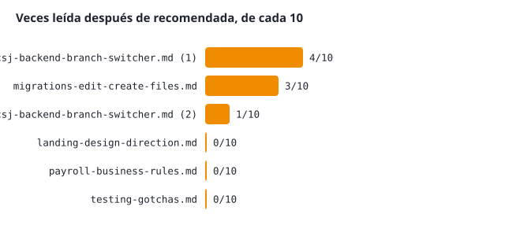

# Synapsis — one shared memory for Claude Code, Codex, and Antigravity

*[Versión en español](README.md)*

Synapsis connects Claude Code, Codex, and Antigravity to the same live memory: each
tool gets real lifecycle hooks (not just an MCP server the model may or may not decide
to call), all pointing at the same engine and the same live 3D memory map.



## What it does

- **A map of your notes.** It gathers each project's memory
  (`~/.claude/projects/*/memory/`) and draws it as a brain: each note is a neuron, and
  every time a note names another one, a connection.
- **Live.** While you work (from any of the 3 tools), you see which note is being read,
  which file is being edited, which agent was launched, and in which chat — all on the
  same page, no matter which of the 3 tools generated it.
- **A health checker.** Reviews the memory: links to notes that no longer exist, notes
  nobody references, duplicate memories, incomplete headers.
- **A search tool.** Says which notes to read first for a topic, flags data that might
  be outdated, and gathers the recorded decisions that touch it — before answering.
- **Learns from your usage.** What gets used together gets connected; what stops
  repeating gets forgotten. Each machine learns from its own usage.

What `synapsis` adds on top of that: the three tools (Claude Code, Codex, Antigravity)
feed and read **the same** brain, with real hooks in all three — not only in the one
that has the official plugin.

## How the engine searches and learns, in short

It's not semantic indexing and there are no embeddings: it's lexical word search
(BM25-style, with typo correction), combined with a graph of which notes and files get
used together. That graph is actually pruned — weak connections fade away on their
own over time, they don't pile up forever.

**What it learned on its own**, with nobody telling it which files belonged together
(real output from `cerebro.py --aprendido`, taken after the session where a new
category was added to a service catalog — the files touched together are exactly the
ones it connected):



**How well it actually works in practice, unvarnished:** of the notes it recommended,
this is how many times they actually got read afterward (out of every 10 times it
recommended them):



This is honest on purpose: some notes get used afterward almost every time, others
almost never. It's not a marketing number — it's the real metric the engine itself
keeps (`aprendido.json`) to calibrate itself.

## What real benefit this has for a project

- **Less "we already decided this," repeated.** An architecture decision, a non-obvious
  business rule, a testing gotcha — they become a note tied to the code they touch. The
  next time anyone (or any of the 3 AIs) touches that code, the note surfaces on its
  own, before the question gets asked again or the same mistake repeats.
- **It doesn't depend on which AI you used that day.** If the decision got written down
  while working with Claude Code, and you open Codex the next day, the note still
  shows up — before `synapsis`, each tool had its own silo.
- **Stale memory cleans itself up.** If something got noted and never got used again,
  its weight decays; if a note goes stale or points at code that no longer exists, the
  health checker flags it for review instead of leaving it as silent truth.

## How it does it

Each tool has its own "hook" format (a lifecycle event: a session started, it's about to
use a tool, it finished, etc.) and its own config file. `synapsis` doesn't invent a new
protocol — it translates:

| Tool | Where it writes config | What it translates |
|---|---|---|
| **Claude Code** | `~/.claude/settings.json` | Nothing: it uses the engine's own `hook_*.py` scripts, the same event names. Replaces the marketplace plugin (disables it to avoid duplicate events). |
| **Codex** | `~/.codex/hooks.json` + `config.toml` | 12 lifecycle events (`SessionStart`, `PreToolUse`, `Stop`, etc.) into the shape the engine expects, plus an MCP server (standard protocol) with 7 tools. |
| **Antigravity** | `~/.gemini/config/hooks.json` | 5 events (`PreInvocation`, `PreToolUse`, `PostToolUse`, `PostInvocation`, `Stop`), also translating its own tool names (`run_command` → `Bash`, `view_file` → `Read`, etc.) into the ones the engine recognizes. |

The vendored engine (`engine/`) never knows which of the 3 called it — it just receives
events in the same shape, which is why they all end up in the same place:
`~/.claude/plugins/data/neuromapa-neuromapa/en-vivo/eventos.jsonl` (the log that feeds
the map) and `~/.claude/projects/*/memory/` (the actual notes, which were already
shared per project before `synapsis` existed — see "Myths" below).

## Install

```sh
python3 bin/synapsis install              # interactive selector: shows what can be installed before you choose
python3 bin/synapsis install claude        # Claude Code only
python3 bin/synapsis install codex         # Codex only
python3 bin/synapsis install antigravity   # Antigravity only
```

The selector runs the same check (`--dry-run`) it would use to install, so what you see
in the menu is real, not a guess:

```
¿Dónde instalo Synapsis?
  1) Claude Code  [OK]
  2) Codex        [OK]
  3) Antigravity  [OK]
  4) Todas las que digan OK
```

If something can't be installed (for example, an MCP server from a different config
already occupying the name "neuromapa" in Codex), the reason shows up right there,
before you pick.

Each installer adds the hooks without touching the ones you already have (it backs up
to `~/.claude/neuromapa-backups`, `~/.codex/neuromapa-backups`, or
`~/.gemini/config/neuromapa-backups` before writing, and it's safe to run again if you
install a new tool later). To only check without changing anything, add `--dry-run`.

### After installing

- **Claude Code**: restart the app. If you had the "neuromapa" plugin active, it got
  disabled — you lose `/neuromapa:abrir`, `/neuromapa:salud`, and `/neuromapa:sobre`
  (those are the plugin's); use the scripts in `engine/` directly if you need them.
- **Codex**: restart the app and trust the new hooks with `/hooks` in the CLI — Codex
  doesn't trust new hooks on its own.
- **Antigravity**: restart the app.

If you'd rather use a different copy of the engine, set `NEUROMAPA_ROOT` to that path
before installing; to force the data folder, `NEUROMAPA_DATA`. Both are resolved in
`comun.py`.

## Tests actually run (real numbers from this machine, not estimates)

Measured with `time` on this installation, on 2026-10-11:

| Operation | Real time |
|---|---|
| `install_claude_code.py --dry-run` (validates 17 hooks) | 0.040 s |
| `install_codex.py --dry-run` (validates 12 hooks + MCP) | 0.044 s |
| `install_antigravity.py --dry-run` (validates 5 hooks) | 0.040 s |
| One real Codex hook end-to-end (receives the event, translates it, writes to the log) | 0.119 s |

Functional verification (not just shape): each one was really installed in a separate
test folder, sent a real event with the exact payload each tool actually sends, and
confirmed it showed up in `eventos.jsonl` — for all 3. The full detail of what was
tested and what's still untested live (inside the real app, not simulated) is under
"Still to verify" below.

## What each installer does

- **Claude Code** (`claude-code/`): writes the 17 hooks directly into
  `~/.claude/settings.json`, pointing at the `hook_*.py` scripts the engine already
  ships (the same ones the marketplace plugin uses, which is why nothing needs
  translating here).
- **Codex** (`codex/`): translates Codex's 12 lifecycle events into the engine's
  format, and adds the MCP server (`sobre`, `buscar`, `leer_nota`, `avisar_charla`,
  `guardar`, `abrir_mapa`, `salud`) for when the model decides to use them directly.
- **Antigravity** (`antigravity/`): translates its events (`PreInvocation`,
  `PreToolUse`, `PostToolUse`, `PostInvocation`, `Stop`) into the same format.

## Myths worth clearing up

- **"If I never installed Claude Code, I have no memory."** False: the notes folder
  (`~/.claude/projects/.../memory/`) gets created by whoever writes to it first, no
  matter which of the 3 tools that is. What *is* uneven: the *habit* of saving memory on
  its own, without being asked, is an instruction from Claude Code's own product (its
  system prompt), not something the engine enforces — Codex and Antigravity only do it
  if their model decides to call `guardar` on its own.
- **"Memory is stored inside this repo."** No, and it shouldn't be: it lives in a folder
  per project (`~/.claude/projects/<your-project>/memory/`), so one project's memory
  doesn't mix with another's. This repo only holds the engine and the bridges.

## Maintaining the vendored engine

`engine/` is a fixed copy, not a link to the original: if a new version ships upstream,
it doesn't arrive on its own. To update it: clone the upstream project again (see the
footer), copy the `.py` files over `engine/` (without overwriting anything of
`synapsis/`'s own, which lives outside that folder), and run `bin/synapsis install`
again on each machine.

## Still to verify

The Codex bridge passed logic tests for all 12 events, but only 2 (`SessionStart`,
`Interrupt`) were ever confirmed with real events from the real app (not hand-simulated,
like the tests above). The Antigravity one and the Claude Code one (writing directly
into `settings.json` instead of using the plugin) weren't tested with the real app
running either — only with hand-simulated payloads, identical in shape to the real
ones. If something doesn't show up on the map, check whether the hook ran before
assuming something is broken.

## Real limitation

No bridge gives Codex or Antigravity the exact equivalent of Claude Code's automatic
`UserPromptSubmit` hook for always surfacing context: the bridge calls the engine, but
if that tool's model doesn't use the context the hook injects, there's no way to force
it from here.
