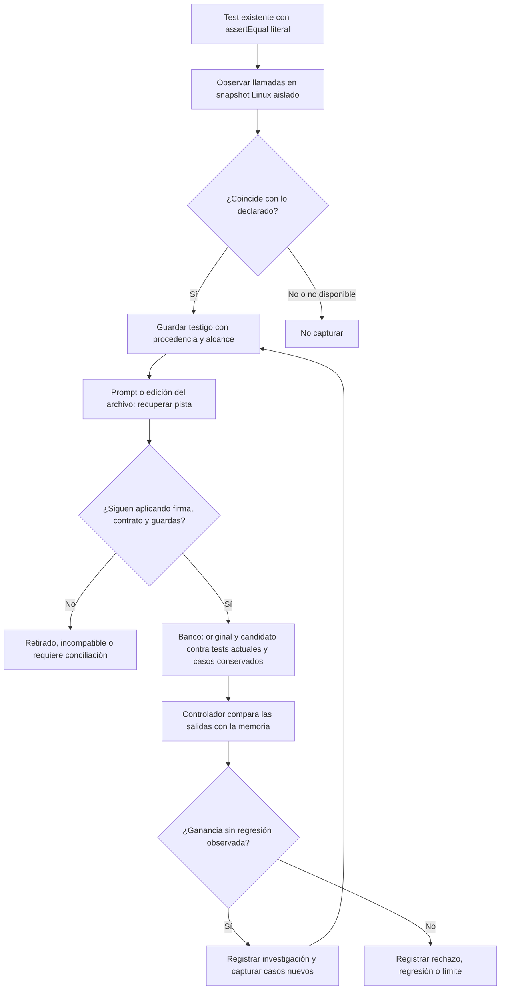
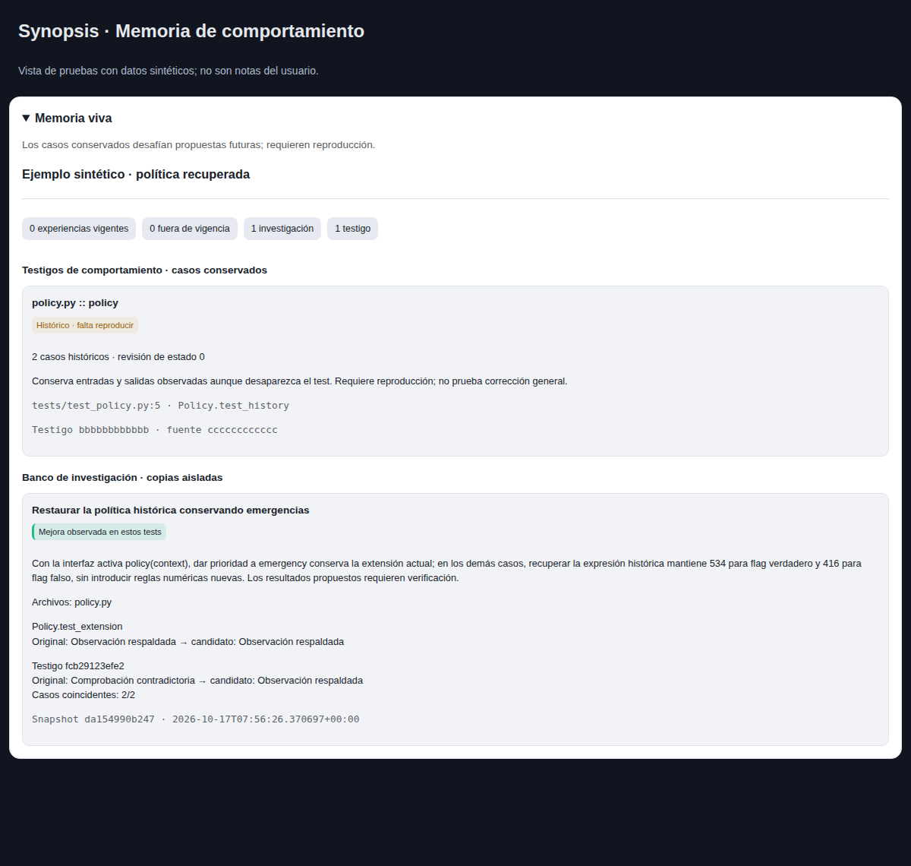

# Memoria de comportamiento verificable

Synopsis conserva ejemplos ejecutables de lo que un componente hizo bajo un contrato
declarado. Si después desaparece el test original, esos casos siguen disponibles para
desafiar una propuesta. La memoria aporta tanto contexto al modelo como controles al
banco de investigación. No depende de que el modelo recuerde pedir cada comprobación.

Un **testigo** contiene llamadas JSON, salidas observadas, firma de la función,
archivo/test/línea/hash de procedencia y, cuando corresponde, revisión de experiencias,
guardas y evidencia independiente de política. Se almacena en SQLite privado por
proyecto. La captura no necesita inferencia ni un proveedor de embeddings.



## Uso

El contexto de cada prompt y el hook anterior a editar muestran pistas de los testigos
relevantes. `experience investigate --execute` incorpora sus casos a la comparación,
además de los tests actuales, y captura casos nuevos tras una mejora observada.
El panel **Memoria viva** muestra estado y procedencia sin ejecutar código por HTTP.



Para capturar explícitamente casos de un test que todavía existe:

```sh
printf '%s' '{"checks":[{"kind":"python_unittest","path":"tests/test_policy.py","case":"Policy.test_modes"}]}' | synopsis experience capture-witness --project /ruta/proyecto --path policy.py --symbol policy --source user:contract --execute
synopsis experience witnesses --project /ruta/proyecto --path policy.py --symbol policy
synopsis experience verify-witness --project /ruta/proyecto --witness ID --execute
synopsis experience retire-witness --project /ruta/proyecto --witness ID --state-revision 0 --reason "Contrato retirado"
```

Sin `--execute`, `verify-witness` solo observa vigencia. Capturar y reproducir exigen
Linux y `bwrap`; si falta aislamiento, se informa no disponible, sin ejecutar en el
host. El agente puede usar MCP `experiencias` con `witnesses`, `verify-witness` y
`retire-witness`; ninguna de esas operaciones ejecuta código. Retirar exige la secuencia
leída y conserva el historial. No se reactiva un testigo por volver a capturarlo.

## Límites que importan

- Prototipo para funciones Python públicas, sin decoradores, llamadas/salidas JSON y
  aserciones `self.assertEqual` directas con argumentos y expectativas literales.
  No extrae reglas generales de una narrativa, ramas de tests o llamadas no literales.
- Se conservan resultados realmente observados, no un `passed: true` del candidato.
  Las expectativas no se incluyen en el mensaje de entrada del ejecutor de llamadas;
  el controlador compara sus salidas. Esto no es un entorno resistente a cualquier
  manipulación de código Python malicioso dentro del proceso observado.
- Un cambio de implementación obliga a reproducir; no invalida por sí solo el testigo.
  Una firma incompatible, revisión/guardas/política cambiadas, retiro o un `assertEqual`
  actual opuesto suspenden su aplicación. El descubrimiento es acotado; no constituye
  un detector completo de cambios contractuales expresados en lenguaje natural.
- El banco admite hasta dos testigos completos y 6000 caracteres de casos. Si omite
  controles aplicables por presupuesto, no certifica mejora del candidato afectado.
  La consulta por función evita que historia reciente de otros archivos lo oculte.
- Un testigo solo respalda sus entradas y alcance. No prueba causalidad, cobertura de
  todos los inputs, equivalencia semántica, seguridad en producción ni ausencia de
  alucinaciones. Los prototipos nunca se aplican automáticamente al checkout.

La evaluación competitiva usa el mismo controlador de reproducción para todos los
perfiles. Así distingue el coste de adquirir/recuperar memoria del beneficio del
ejecutor común. Véase `competitive_protocol.json` y los resultados conservados.
