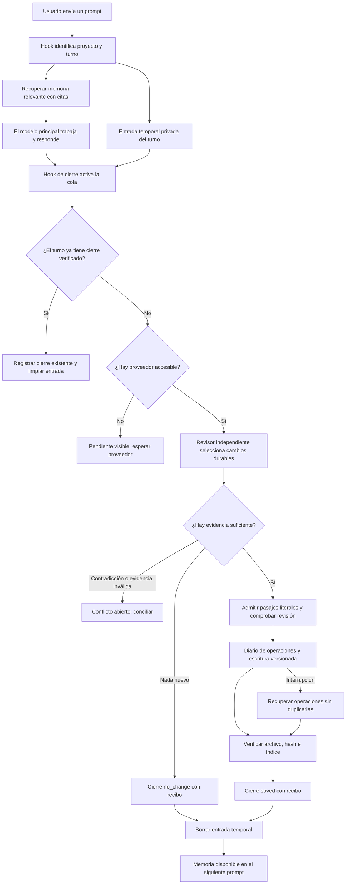

# Continuidad de trabajo y memoria comprobable

Synopsis distingue tres cosas: el contexto recuperado para una tarea, el estado de
trabajo resumido por un agente y el conocimiento durable en notas versionadas.
Conservar un recibo de escritura prueba persistencia, no la verdad de una afirmación.

## Ciclo de una tarea

1. Abrir un turno por proyecto y sesión/tarea.
2. Recuperar evidencia vigente con citas y presupuesto de contexto.
3. Leer el checkpoint previo, si existe; es un resumen del agente que hay que verificar.
4. Proponer conocimiento durable y conciliarlo con las notas vigentes.
5. Persistir las operaciones antes de aplicarlas.
6. Comprobar la revisión, la huella y la proyección Markdown de cada escritura.
7. Cerrar como saved o no_change con motivo; conservar abiertos los conflictos.

El diario guarda huellas del prompt y de la sesión. No almacena la conversación
completa. Las propuestas sí contienen el texto seleccionado para memoria. Se limita
su tamaño, se rechazan formatos reconocibles de credenciales y se conservan con
permisos privados. Este filtro no detecta cualquier posible secreto: el agente debe
seleccionar información apropiada.

## Integración automática y su alcance

Los adaptadores instalados usan hook_cycle.py. Al enviar un pedido se abre el turno
y, donde el cliente permite inyección, se añade un paquete de evidencia por proyecto.
Al comenzar una sesión se reintentan operaciones recuperables de hasta tres turnos
pendientes del mismo proyecto. Los conflictos de revisión necesitan conciliación y
no se reintentan forzando la escritura. No se cierra automáticamente un turno solo
porque terminó la generación del modelo.

Un aviso posterior a herramientas se entrega como máximo una vez por turno. Se
conservan los controles del cliente sobre ejecución de hooks. Cursor no permite
inyectar contexto en su contrato documentado beforeSubmitPrompt: ahí abre el ciclo,
y la guía inicial pide consultar estado_memoria/MCP. Esta integración cooperativa
no puede exigir que un modelo obedezca o demostrar que haya leído el contexto.

Los identificadores nativos de mensaje/generación deduplican eventos. Sin ellos se
reutiliza el último turno abierto de esa sesión si tiene la misma huella de pedido;
repeticiones idénticas simultáneas no se pueden distinguir con certeza.

## Identidad y compatibilidad de proyectos

Los proyectos nuevos guardan su memoria en SYNOPSIS_DATA/projects/<identidad>/memory
(por defecto, ~/.local/share/synopsis). La ubicación se indexa con SHA-256 de la raíz
canónica; un UUID local registra la identidad del workspace y sus movimientos. La
propiedad se comprueba contra los manifiestos.
Rutas como alpha-beta y alpha/beta quedan separadas; un alias simbólico de la misma
raíz conserva la misma identidad.

Una memoria existente explícitamente asignada en la configuración se vincula en su
ubicación original. No se copian notas, índices, revisiones ni recibos. Las nuevas
memorias registradas también se descubren al iniciar el mapa/buscador, conservando
una sola raíz física por fuente. El descubrimiento respeta el archivo de configuración
donde se registró la vinculación; cargar otra configuración no incorpora esas
memorias automáticamente. El modo demo excluye los registros personales.

Una carpeta antigua sin propietario no se asigna por su nombre codificado, porque
ese nombre puede corresponder a más de una ruta. Si existe tal carpeta, se detiene
la creación automática de otra memoria para evitar duplicar el conocimiento. El
comando siguiente permite inspeccionar el destino sin escribir:

```bash
synopsis memory-location --project /ruta/proyecto
```

Cuando se conoce qué carpeta pertenece al proyecto, se vincula sin moverla:

```bash
synopsis memory-location --project /ruta/proyecto --bind /ruta/memoria/existente
synopsis memory-location --project /ruta/proyecto --bind /ruta/memoria/existente --apply
```

Una carpeta no puede vincularse a otro proyecto si ya tiene propietario. Tampoco se
cambia automáticamente un destino registrado por otro. La vinculación tiene un
registro de intención recuperable: una interrupción entre publicar el propietario
y la ubicación no provoca que el reintento cree una segunda memoria. La propiedad
registrada prevalece sobre una asignación de búsqueda obsoleta o incorrecta.

## Herramientas MCP y CLI

- iniciar_turno_memoria: proyecto, sesión y consulta; devuelve turno, contexto, estado
  de trabajo anterior y el contrato de cierre.
- estado_memoria: pendientes y recibos por proyecto; con turno y operacion muestra
  una propuesta completa. reanudar=true reintenta fallos recuperables de ese turno.
- cerrar_turno_memoria: resultado saved con operaciones o no_change con motivo.
  closed=false conserva el problema visible; no equivale a éxito.

Cada operación usa filename, name, description, kind, content, index_line y source.
state es inferred por defecto. Una actualización exige overwrite=true y
expected_revision de la nota que se leyó. Los conflictos se resuelven leyendo la
versión vigente, descartando la propuesta reemplazada con motivo y enviando una
conciliada. Las operaciones ya aplicadas no se descartan.

El cierre puede incluir checkpoint con goal, progress, next_step y blockers. Se
compara checkpoint_revision con working.revision para no pisar el resumen de otra
sesión concurrente. Una secuencia de confirmación monotónica selecciona el último
checkpoint, aunque los turnos cierren fuera de orden o el reloj retroceda. El esquema
anterior se migra una sola vez usando sus fechas de cierre y un desempate estable;
ese histórico no contenía una secuencia que permitiera reconstruir empates exactos. El checkpoint vive en el diario, fuera de las notas y su índice.

```bash
synopsis cycle begin --project /ruta/proyecto --session tarea-17 --query 'Revisar Redis'
synopsis cycle status --project /ruta/proyecto
synopsis cycle status --project /ruta/proyecto --turn ID --retry
printf '%s\n' '{"resultado":"no_change","motivo":"Solo consulta, sin información durable nueva."}' | \
  synopsis cycle close --project /ruta/proyecto --turn ID
```

## Ejecución controlada por Synopsis

```bash
synopsis run --project /ruta/proyecto --session tarea-17 --prompt 'Revisa la política Redis' -- /ruta/adaptador-modelo
```

Sin comando después de `--`, Synopsis detecta un conector incorporado.
También se acepta el prompt por stdin si se omite --prompt. Un adaptador propio es un
programa explícito del usuario que conecta con su modelo: recibe un objeto JSON por
stdin y devuelve uno por stdout. Este protocolo no convierte automáticamente una
CLI arbitraria en un adaptador. Las cinco integraciones nativas siguen disponibles
sin escribir ese programa; el modo controlado también incluye conectores listos para usar;
consulta [modelos](models.md).

El protocolo actual es synopsis.run.v2; requiere grounding y support además del
contrato de memoria. Consulta [la especificación estricta](evidence_guard.md).
La estructura básica heredada contenía turn, project, prompt, working, memory.evidence,
memory.pending, instrucciones y descripción del contrato de respuesta. El siguiente ejemplo muestra solo los campos básicos heredados; v2 además exige
grounding y support para las escrituras:

```json
{
  "answer": "Respuesta que se entregará al usuario",
  "memory": {
    "outcome": "no_change",
    "reason": "Solo consulta; no hay información durable nueva.",
    "actions": [],
    "checkpoint": {
      "goal": "Revisar la política Redis",
      "progress": "Configuración inspeccionada",
      "next_step": "Ejecutar la prueba de caducidad"
    }
  }
}
```

Para saved, actions contiene operaciones de memoria. Synopsis retiene answer hasta
comprobar el cierre del ciclo. Un contrato ausente, una revisión desactualizada o un
fallo de escritura devuelve un error y el turno pendiente. El proceso se ejecuta
sin shell, en el directorio del proyecto, con límites de tiempo y salida; los errores
no reproducen stderr del adaptador ni la conversación. Los permisos y las acciones
externas del adaptador siguen siendo responsabilidad de su entorno de ejecución.

## Recuperación y concurrencia

Cada operación tiene un identificador y una huella del pedido. Su recibo se confirma
en la misma transacción SQLite que la revisión y el outbox de proyección Markdown.
Si el proceso muere después de escribir y antes de reconocerlo, el reintento
recupera ese recibo y comprueba la proyección. Cambiar el contenido de una operación
con el mismo identificador falla. Una edición humana posterior se conserva y genera
conflicto, no un acuse falso. Los workers de conciliación se serializan para que una
operación no se aplique después de haber sido descartada.

Los lotes se aplican por operación. No son una transacción atómica entre todas las
notas: una parte puede quedar aplicada y otra pendiente. El estado lo muestra y el
cierre saved exige que no haya operaciones sin resolver.

## Validación y desarrollo siguiente

Las regresiones cubren colisiones de rutas, vinculación de memorias existentes sin
copias, interrupciones de esa vinculación, recuperación de checkpoints fuera de
orden y aislamiento mediante MCP, además de muerte real de proceso tras commit, trabajadores concurrentes,
actualizaciones con revisión esperada, checkpoints concurrentes, límites del proceso,
contratos MCP y continuidad entre tres adaptadores en procesos independientes.
Los adaptadores de prueba son programados: validan mecanismos, no calidad de modelos.

Los conectores de inferencia, la recuperación híbrida, las experiencias y la
conciliación asistida están implementados; sus contratos y configuración están en
[modelos](models.md). El motor no deduce la verdad: las contradicciones inciertas
permanecen visibles. La evaluación sintética y las pruebas con proveedores reales
se registran con sus límites en [desarrollo](development.md).


## Política estricta v2

Los ciclos de synopsis run v2 usan un namespace propio y política persistida. Solo
el guard interno puede encolar operaciones admitidas; una llamada MCP genérica no
rebaja esa política. La recuperación vuelve a comprobar soporte pendiente y reconoce
recibos ya confirmados sin repetir la escritura. Las notas sin admisión no se convierten
en evidencia por repetirlas o cambiar su etiqueta de estado.

El resultado working del modo estricto contiene revisión/disponibilidad, sin publicar
texto del checkpoint. Los checkpoints siguen disponibles mediante las herramientas
de estado, identificados como resúmenes del agente. [Contrato completo](evidence_guard.md).

Desde 0.4, la vinculación ocurre en el primer uso. Las memorias anteriores con
metadatos cwd inequívocos se adoptan en su ubicación original; los demás casos se
eligen desde el mapa. El comando memory-location se mantiene como alternativa
explícita. Contrato completo: [project_binding.md](project_binding.md).

## Recordatorio por archivos y revisión de memoria (0.4.1)

El recordatorio de Stop es una heurística de cantidad de archivos. Consulta el
último cierre saved/no_change del proyecto y la sesión completa; los cambios
anteriores a ese cierre ya están revisados. Solo cuenta archivos del proyecto
actual. No transforma no_change en una escritura, y sigue contando cambios nuevos.
Los turnos abiertos o conflictos continúan en el diario y en su aviso específico.
La consulta es de solo lectura y no crea una memoria para decidir si debe avisar.

En 0.4.1 la selección seguía dependiendo del modelo principal. Desde 0.5 el cierre
nativo también despierta un revisor independiente, descrito abajo.

## Revisión automática independiente (0.5.0)

Está activa por defecto en los cinco adaptadores, sin reinstalar hooks si estos ya
apuntan a este checkout. UserPromptSubmit abre el ciclo y deja una entrada temporal;
Stop la pone en cola y lanza un proceso separado. Si el modelo principal ya cerró
el turno con recibo, se respeta ese cierre. No se reabre silenciosamente.

El proveedor predeterminado es el CLI del mismo cliente (Codex, Claude u OpenCode)
o un modelo de generación de Ollama disponible localmente. No se envía el turno de
Cursor o Antigravity a una cuenta de otro cliente por encontrar su ejecutable.
Si no hay proveedor accesible, queda waiting_for_provider, nunca no_change falso.
La existencia de un CLI no demuestra que su autenticación o plan permitan inferencia.
Los hooks nativos conservan sus límites de inyección; este revisor no controla la
respuesta libre del modelo principal ni garantiza relevancia o veracidad perfectas.

El revisor recibe solo el prompt del turno (máximo 10.000 caracteres), la respuesta
final disponible (máximo 10.000), notas acotadas y evidencia local solicitada en una
ronda de hasta cuatro lecturas. Las respuestas del asistente son contexto sin verificar;
no son fuentes admitidas. Solo pasajes literales del usuario o de archivos comprobados
pueden entrar en la memoria, siempre inferred. Los secretos reconocibles y entradas
que superen límites se rechazan antes del envío, sin truncar sus condiciones.
Las detecciones de secretos son heurísticas, no una garantía universal.

Las actualizaciones automáticas solo añaden pasajes a notas admitidas preservando
su contenido anterior y exigiendo revisión esperada. No sustituyen una declaración
antigua contradictoria: dejan conflicto para conciliación. Las notas heredadas sin
admisión tampoco se reescriben automáticamente. La selección semántica de relevancia,
duplicados temáticos y contradicciones la hace el revisor; se comprueban además
citas exactas, duplicados literales, revisión y recibos de persistencia.

La cola SQLite está en la carpeta privada .synopsis de cada memoria, con permisos
600 y secure_delete. Solo retiene la entrada hasta procesarla o durante 24 horas;
la expiración se aplica en el próximo acceso a la cola, no por un temporizador global.
No captura herramientas, resultados de shell, razonamiento interno ni conversaciones
completas. Guarda el estado/recibo después de borrar la entrada temporal. No equivale
a borrado forense de copias externas, snapshots o respaldos del sistema.

Un lease y un candado por proyecto evitan inferencias simultáneas del mismo trabajo.
El diario permite recuperar escrituras aplicadas sin una nueva propuesta. Los fallos
recuperables se reintentan al siguiente SessionStart/Stop (máximo tres intentos);
si no hay nuevos eventos no existe un demonio periódico que los despierte. Los
conflictos, entradas rechazadas y trabajos vencidos mantienen abierto el ciclo original.

```bash
synopsis reviews --project /ruta/proyecto
synopsis reviews --project /ruta/proyecto --retry
```

El diagnóstico muestra activación y la ruta para consultar recibos, sin afirmar que
la instalación comprobó autorización de inferencia. Como opciones avanzadas:
SYNOPSIS_AUTO_REVIEW=0 desactiva esta revisión; SYNOPSIS_REVIEW_PROVIDER y
SYNOPSIS_REVIEW_MODEL permiten elegir explícitamente otro proveedor. No se necesitan
para Codex/Claude/OpenCode con CLI autenticado y acceso de inferencia, u Ollama local.

Claude/Codex entregan last_assistant_message; OpenCode recoge solo partes textuales
assistant del turno actual. Cursor/Antigravity pueden aportar ese campo si su host
lo entrega; en otro caso el revisor trabaja con el prompt, sin leer su historial.
La compacción o cierre inesperado antes de Stop puede dejar awaiting_stop hasta
expiración; no inventamos una respuesta final. Los agentes cloud requieren instalación
junto al proceso que emite los hooks.



Contratos nativos consultados: [Claude Stop](https://code.claude.com/docs/en/hooks#stop),
[Codex Stop](https://learn.chatgpt.com/docs/hooks) y
[eventos de OpenCode](https://opencode.ai/docs/plugins/#events). La compatibilidad
interactiva con todos los hosts no se deduce de esos contratos.


## Cambios de recuperación en 0.6

La descripción 0.5 anterior es histórica: en 0.6 los cierres previos también pasan
por una revisión independiente enlazada; agotar intentos conserva la entrada hasta
su vencimiento. El mapa activo revisa colas cada 30 s. El inventario prioriza relevancia.
El ciclo completo de experiencias y sus límites están en [experiences.md](experiences.md).
