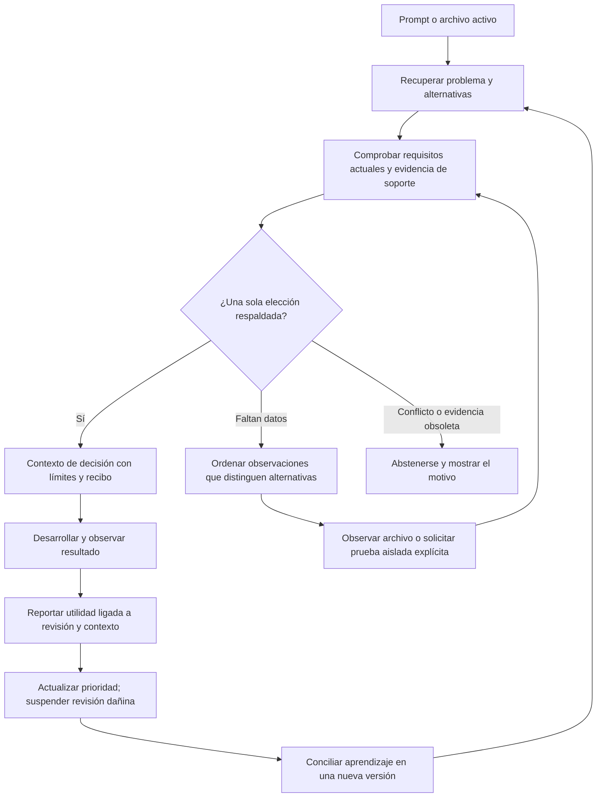

# RAG de decisiones · Synopsis 0.8

## Qué hace

Recupera un conjunto de experiencias que comparten un problema, incluidas acciones
opuestas, y comprueba qué condiciones las separan. Puede seleccionar una acción bajo
observaciones declaradas, abstenerse, o entregar la comprobación que falta. Las
explicaciones y relaciones causales siguen siendo inferencias.



El revisor automático puede proponer casos cuando los archivos leídos contienen
respaldo suficiente. No inventa condiciones para rellenar un caso: una experiencia
sin límites verificables permanece en la memoria anterior. Dos elecciones opuestas
usan la misma clave de problema y registros diferentes. No se fusionan en silencio.

## Contrato del caso

Se añade este campo opcional al formato de [experiencias](experiences.md):

```json
{
  "decision": {
    "key": "payment-timeout",
    "choice": "retry",
    "requires": [
      {"kind":"json_equals","path":"context.json","pointer":"/idempotent","expected":true}
    ]
  }
}
```

`requires` admite entre una y seis comprobaciones declarativas. Cada ruta tiene que
figurar en `evidence` con su huella al registrar el caso. Además se exige evidencia
y al menos un `check` independiente de esas rutas: código, contrato o prueba.
Una configuración aislada no justifica por sí sola elegir una acción.

Las rutas de requisitos representan contexto dinámico: se vuelven a observar al
recuperar. El resto del soporte queda ligado a su hash; un cambio lo invalida.
Las guardas de `when.conditions` y `requires` se deduplican. Una guarda repetida en
`checks` no convierte todo el JSON en soporte inmutable: se vuelve a evaluar el
predicado actual. Un cambio en otro campo no invalida esa condición. El contrato,
código o prueba independiente continúa ligado a su hash.
Las condiciones previas `when.conditions` siguen siendo obligatorias. Cambiar
versiones/dependencias invalida un caso si se citaron sus manifiestos como soporte;
Synopsis no descubre automáticamente todas las dependencias no declaradas.

## Decisión y adquisición de evidencia

- La recuperación inicial usa texto y ruta. Agrupa por clave y conserva todos los
  casos del grupo, incluso requisitos contradichos. El feedback ajusta la prioridad
  de grupos dentro de un margen, nunca convierte un check falso en verdadero.
- Una propiedad JSON ausente, un archivo ilegible o JSON ambiguo producen unknown.
  `false` y `0`, o `true` y `1`, son valores distintos. No se usa una ausencia como
  prueba de una negación. `text_contains` solo prueba presencia literal.
- Dos elecciones elegibles producen conflict. Una alternativa desconocida impide
  cerrar prematuramente la decisión. Un grupo con más de ocho casos o que no cabe
  completo en el presupuesto queda sin selección. Se entregan hasta tres grupos.
- Las observaciones pendientes se agrupan por propiedad para evitar leerla dos veces.
  Se prioriza cuántas elecciones ayudan a distinguir; en empate se prefiere lectura
  a ejecución. Es una heurística explícita, no valor de información probabilístico
  ni una garantía de coste mínimo global. No se generan comandos arbitrarios.
- La recuperación ordinaria observa archivos; no ejecuta tests. `--execute` puede
  reejecutar hasta tres checks existentes (dos por defecto), solo cuando los requisitos
  del caso se observan satisfechos. Usa el ejecutor Linux aislado ya documentado.
  Sin capacidad de aislamiento queda pendiente, nunca aprobado.
- Después de una ejecución se compara la huella de toda la copia filtrada con el
  proyecto actual y se revalidan guardas/soporte. Las selecciones pertenecen a ese
  instante; los hooks no bloquean una edición posterior ni obligan al modelo a obedecer.

## Instalación y uso

No requiere otro proveedor, vector DB, dependencia Python ni configuración adicional.
Los adaptadores existentes llaman a la capa en cada evento de prompt/pretool que su
cliente permita. Cursor conserva sus restricciones de inyección; compatibilidad no
significa que cada cliente soporte todos los eventos. La skill compartida explica
cómo pedir decisiones y reportar resultados mediante MCP.

```bash
synopsis experience decide --project /ruta/proyecto --query 'payment retry timeout' --path src/payments.py
synopsis experience decide --project /ruta/proyecto --query 'payment retry timeout' --execute --max-probes 1
synopsis experience outcome --project /ruta/proyecto --plan RECIBO --name retry --outcome useful --event tarea-123 --source agent:session
```

MCP `experiencias` añade `operacion: decide|outcome`; usa consulta, ruta, presupuesto,
plan, nombre, resultado, evento y fuente. No expone ejecución. La herramienta ya
existente mantiene record/recall/verify/history/feedback, sin otra configuración MCP.
El modo controlado recibe decision_context como dato inferido; conserva su salida
extractiva y sus requisitos estrictos de admisión.

## Aprendizaje y trazabilidad

Los planes explícitos/MCP y de prompt guardan un recibo determinista en el mismo
SQLite de experiencias. Incluyen huella de consulta, versiones, observaciones y
límites; no guardan la consulta literal. El mismo plan se reutiliza sin duplicación.
Las sugerencias pretool no persisten un plan por cada lectura de archivo.

`outcome` exige una alternativa seleccionada y el mismo contexto/revisión. Su recibo
identifica utilidad **reportada**, no un efecto causal medido ni una prueba de que el
agente ejecutó la acción. Un evento repetido es idempotente; un evento contradictorio
se rechaza. Un reporte harmful suspende la selección de esa revisión. La corrección
exige conciliar explícitamente el caso con `record --revision N`; se conservan los
antecedentes. El sistema no inventa una regla general a partir de un solo fallo.

Los planes y outcomes se conservan localmente como historial; no hay sincronización
ni exportación automática a terceros. No se entrena el modelo ni se descubre toda
la causalidad del proyecto. Un caso mal formulado puede tener todos sus checks
verdaderos y aun así recomendar mal: las pruebas y la revisión siguen siendo necesarias.

## Evaluación reproducible

```bash
python3 -B tools/evaluate_decision_rag.py
python3 -B tools/evaluate_decision_rag.py --execute
python3 -B tools/evaluate_decision_rag.py --live --provider codex
```

Tres problemas ficticios: reintentos/idempotencia, caché/consistencia y renombrado de
esquema/compatibilidad. Cada prompt se mantiene igual mientras cambia una condición.
Se prueban valores positivo, negativo, ausente, de tipo incorrecto y soporte cambiado,
además de resolver una observación pendiente por problema: 18 escenarios.

Los controles deterministas eligen el primer resultado de recuperación: no simulan
el razonamiento de un LLM ni representan a otros productos. Las ablaciones eliminan
requisitos, vigencia o casos opuestos del mismo conjunto. En modo live los tres brazos
usan el mismo proveedor, contrato de salida y tope de contexto; todos reciben las
mismas observaciones actuales. Se registran errores de formato, una reparación máxima
y latencia por inferencia. No se miden facturación/tokens ni coste de mantenimiento.

Esta batería mide el mecanismo en fixtures. No demuestra mejora estadística en tareas
de programación reales, superioridad comercial, novedad científica ni eliminación
de alucinaciones. Esa validación requiere repositorios y tareas reservados que no
hayan guiado el diseño del motor.

## Resultados de esta entrega

- 18/18 escenarios deterministas del mecanismo.
- Codex real: 45 inferencias, 15 por brazo. El RAG de decisiones obtuvo 15/15;
  recuperación de un único caso, 12/15; contexto de Synopsis 0.6, 11/15.
  Los siete desaciertos de esos controles fueron abstenciones, no acciones peligrosas.
  No se observaron errores de formato en esta corrida. Es una muestra pequeña,
  sintética y sin repeticiones; no permite concluir superioridad general.
- Dos pruebas Linux aisladas y un control negativo aprobados; HOME y variable privada
  excluidos. Se aplican límites de 32 procesos, archivos de 1 MiB y `/tmp` de 16 MiB,
  además de CPU/memoria/tiempo/salida; se deshabilitan nuevos namespaces de usuario
  y se retiran capabilities. Una plataforma incompatible devuelve unavailable.
- Resultados y procedencia: [decision_evaluation.json](decision_evaluation.json).


## Recuperación híbrida y observación discriminante (0.8)

BM25 sobre relato, límites y contratos citados, anclajes de rutas/identificadores y
embeddings multilingües locales se fusionan por rango recíproco. La coincidencia de
texto no puede saltar condiciones falsas, soporte obsoleto, conflictos ni daño
reportado. `retrieval` expone modo, disponibilidad y canales; no es confianza.
[Instalación, privacidad y límites del modelo](local_semantics.md).

Cuando falta una observación, `probes` muestra particiones de las elecciones por
valor declarado y prioriza la eliminación mínima en esas particiones. Es una
heurística discreta: no estima probabilidades ni prueba causalidad. Persisten los
límites de tres grupos por paquete y ocho alternativas por grupo; si faltan espacio
o capacidad, devuelve el motivo sin elegir entre un conjunto truncado.

`experience explore --name CASO --project /ruta` planea cambios de una guarda JSON
booleana por vez sobre una prueba Python existente. `--execute --max-probes 3`
ejecuta hasta tres variantes en copias desechables aisladas mediante bwrap en Linux.
No modifica el checkout. Distingue prueba sensible al contexto, prueba que siempre
pasa, contradicción basal y runner no disponible. El resultado queda ligado a la
revisión y snapshot, como observación histórica. MCP solo permite planear.
