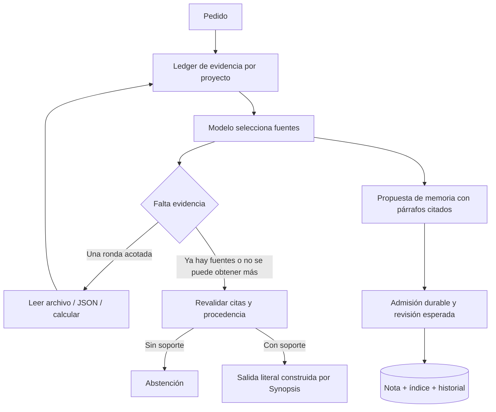

# Salida con evidencia y admisión estricta

## Garantía y límite

En `synopsis run` v2, el modelo selecciona fuentes y propone operaciones. Su borrador
libre no se publica como respuesta factual. Synopsis construye la salida con extractos
literales comprobados, valores JSON leídos del proyecto o cálculos decimales exactos.
Si falta respaldo, devuelve abstención. Un recibo de escritura es una confirmación
mecánica separada del contenido del modelo.

La garantía es **fidelidad a una fuente observada**, no verdad universal. Una decisión
recordada prueba lo registrado, no que esa decisión sea correcta o siga aplicándose
al mundo. Un archivo puede contener información falsa; leerlo no demuestra que el
sistema esté ejecutando esa configuración. Elegir una fuente irrelevante también
sigue siendo posible. Las citas y sus fechas permiten revisar esos límites.

Este modo sacrifica la prosa libre y las síntesis no verificables. No es una evaluación
de todas las afirmaciones posibles de un modelo ni una promesa de cero alucinaciones.
No sustituye validaciones del dominio, pruebas reales o fuentes externas autorizadas.

## Flujo



## Evidencia admitida

- `user_input`: el mensaje actual, útil para conservar una declaración literal del
  usuario. No sirve como respuesta a su propia pregunta ni verifica una verdad externa.
- `project_file`: texto leído de un archivo del proyecto con huella y líneas.
- `json_value`: valor obtenido mediante JSON Pointer. Rechaza claves duplicadas,
  valores no finitos y subárboles sensibles; conserva decimales sin pasar por floats.
- `calculation`: operaciones +, −, × y ÷ con Decimal, límites de tamaño/complejidad y
  sin ejecución de código. Rechaza cálculos que requieren redondeo no solicitado.
- `memory_record`: nota cuya versión actual coincide con una escritura confirmada
  y una admisión estricta durable. Se presenta como registro histórico.
- `unverified_memory`: nota sin esa admisión, con origen cambiado o soporte inválido.
  Se conserva para inspección, pero queda fuera de la respuesta y de nuevas admisiones.

La procedencia declarada por otro cliente y `state=confirmed` no otorgan esta admisión.
Una edición manual, un guardado ordinario o una conciliación que sintetiza contenido
pueden dejar una nota en cuarentena. No se borran notas ni se crean copias para migrarlas.
Una reconfirmación explícita del usuario puede actualizar la misma nota, con revisión
esperada, y generar una nueva admisión sin duplicarla.

Los checkpoints siguen siendo resúmenes no verificados del agente. La respuesta del
modo estricto devuelve su revisión y disponibilidad, sin publicar su texto como hecho.
El siguiente turno puede usarlos como contexto de trabajo no confiable.

## Contrato v2

Se conserva la entrada por stdin y el resultado JSON para adaptadores propios. Cambia
el protocolo a `synopsis.run.v2`: no hay una degradación automática al modo v1.
El request incluye `grounding_evidence.sources` con identificadores generados por el
controlador. La respuesta mínima del adaptador es:

```json
{
  "answer": "Borrador interno que no se publica",
  "grounding": {"sources": ["ev-ID-REAL-DEL-REQUEST"], "abstain": false},
  "memory": {"outcome": "no_change", "reason": "Solo consulta", "actions": []}
}
```

Sin evidencia suficiente, usa sources:[] y abstain:true. Los ids ficticios fallan.
Para guardar, cada acción necesita filename y support; kind es opcional:

```json
{
  "filename": "iris-policy",
  "support": [{"source": "ev-ID-REAL-DEL-REQUEST", "quote": "Párrafo literal completo de esa fuente."}]
}
```

Los párrafos se delimitan por líneas en blanco. No se permite recortar una negación
dentro del párrafo. Synopsis construye cuerpo, descripción, índice, claves y origen;
no incorpora las afirmaciones que el modelo añada a esos metadatos. Siempre registra
las citas como inferred, sin convertirlas en verdad externa. Para actualizar agrega
overwrite:true y expected_revision obtenido del inventario.

La selección de qué información conservar o reemplazar sigue siendo una decisión del
modelo. El historial protege el contenido previo y la revisión protege la concurrencia;
ninguno demuestra conservación semántica perfecta. Si no se pueden preservar hechos
vigentes mediante citas completas, el modelo debe abstenerse de actualizar.

## Herramientas acotadas

Puede haber una sola ronda adicional con hasta cuatro solicitudes, dentro del tiempo
restante del turno. Las herramientas son read_file, memory_note, json_value y calculate.
No reciben comandos arbitrarios. Lecturas: archivos regulares de hasta 2 MB, tramos de
hasta 80 líneas y presupuesto global de evidencia de 24 000 caracteres/16 fuentes.
La respuesta selecciona hasta seis fuentes.

Las rutas deben pertenecer al proyecto; no se siguen enlaces simbólicos. En POSIX se
abren sus componentes mediante descriptores para impedir el intercambio de una carpeta
por un enlace durante la lectura. Los archivos sensibles y ocultos se excluyen, con
excepciones documentales para `.agents/docs` y `.github`. Una carpeta de memoria no se
puede leer como archivo ordinario para saltarse la cuarentena. Los bloques de salida
se muestran como texto literal para no activar HTML o imágenes de una fuente.

En Codex, el conector de inferencia usa autenticación existente y el modelo de la CLI
(o --model), omite la configuración personal de esa invocación y desactiva shell,
colaboración y búsqueda. No modifica su configuración global. Si necesitas un gateway
personalizado, usa el conector compatible explícito. Otros clientes mantienen sus
propias restricciones. Las herramientas de evidencia de Synopsis no ejecutan shell.
[Configuración oficial de Codex](https://learn.chatgpt.com/docs/config-file/config-reference).

## Recuperación durable

El diario guarda la política del turno y una admisión por operación, ligada a su
contenido canónico. MCP/CLI genéricos no pueden encolar cambios en ese turno sin la
capacidad interna generada por el guard. La política no puede rebajarse al reanudar.
Los turnos estrictos usan un namespace de sesión separado del protocolo anterior.

Antes de aplicar una operación pendiente se vuelven a comprobar archivos y huellas de
su soporte. Una operación ya confirmada puede recuperar su recibo tras una interrupción,
incluso si ella misma actualizó una nota de soporte. Se comprueban proyección e índice.
Las cadenas de admisión se validan con detección de ciclos y límite de profundidad.
El usuario que controla los archivos y SQLite puede alterarlos: no es una defensa
criptográfica frente al propietario del equipo. Hay una ventana normal entre observar
archivos externos y actuar; las huellas describen una observación, no un bloqueo del mundo.

## Uso en IDE y CLI

```bash
synopsis run --project /ruta/proyecto --prompt '¿Qué retención habíamos decidido?'
printf '%s\n' '{"fuentes":[{"tool":"json_value","path":"settings.json","pointer":"/ttl"}]}' |
  synopsis verify --project /ruta/proyecto
```

MCP `responder_con_evidencia` acepta proyecto y fuentes y devuelve la misma salida
extractiva. Una petición memory_note usa filename sin extensión. **Los hooks y MCP no
interceptan toda la respuesta del IDE**: el agente puede ignorar una herramienta.
La puerta de publicación completa pertenece a synopsis run v2. El guard no transforma
una frase libre posterior del IDE en una afirmación verificada.

## Evaluación

`python3 -B tools/evaluate_guard.py` ejecuta diez adaptadores deliberadamente adversos:
sin evidencia, cita inventada, escritura sin apoyo, borrador falso con archivo real,
archivo cambiado, memoria contaminada, cálculo, comando prohibido, rondas ilimitadas y
valor JSON. Comprueba que no se filtre el borrador ni se guarde una propuesta sin apoyo.
Esto mide aplicación de reglas, no una tasa de alucinación en modelos reales.

Las pruebas adicionales cubren negaciones entre líneas, precisión decimal, JSON ambiguo,
rutas, marcado malicioso, admisiones falsas, reanudación tras commit, degradación de
política y contaminación a través de cadenas de recuerdos.

`tools/evaluate_continuity.py` usa un modelo real, estado temporal y datos ficticios.
Comprueba una corrección conservando otro dato y una consulta en un proyecto sin memoria.
Cada ejecución puede incluir una ronda de evidencia y una reparación estructural acotada;
no se presenta como una comparación entre modelos si se usa el mismo cliente por defecto.
