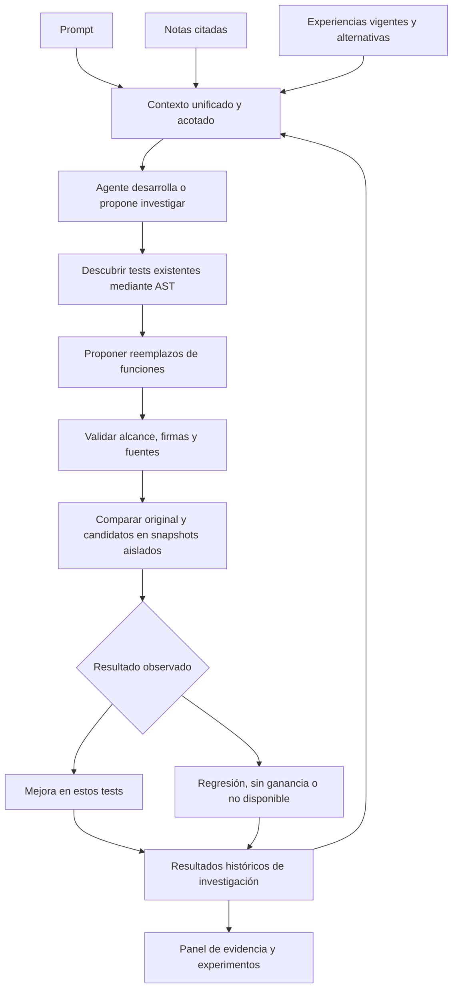
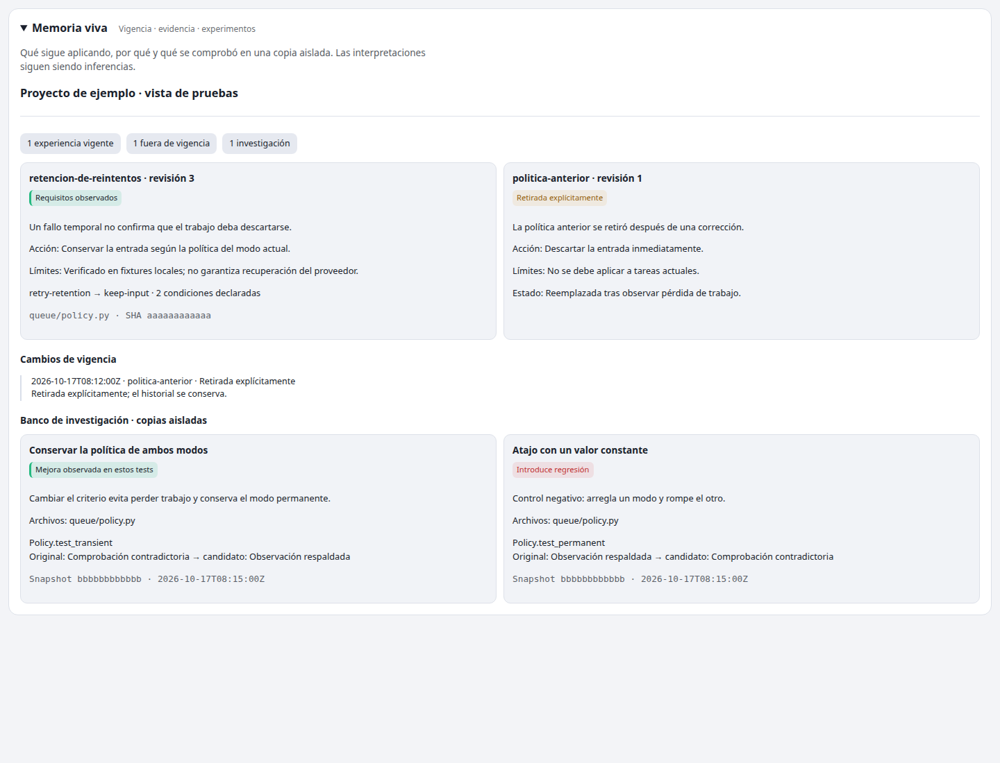

# Memoria e investigación en Synopsis

Desde 0.10 el banco también conserva y reproduce [testigos de comportamiento](behavior_memory.md).
El flujo 0.9 descrito abajo sigue vigente; los tests actuales se complementan con
casos históricos aplicables, sin convertirlos en una prueba de corrección general.

La integración combina recuperación diversa, vigencia explícita e investigación de
código con resultados persistentes. Conserva el mapa e incorpora el panel **Memoria
viva**, con estados, evidencia, cambios de vigencia y comparación original/candidato.
No reemplaza la memoria por un grafo externo ni requiere configurar otro servicio.



## Un solo presupuesto de contexto

El hook de cada prompt usa `synopsis.task-context.v1`: notas, grupos de decisiones,
experiencias sin grupo e investigaciones históricas. El presupuesto predeterminado
es 9000 caracteres de JSON compacto, no tokens. Las notas se diversifican mediante
una penalización de solapamiento léxico; esto no es un nuevo modelo ni confianza.
Un grupo de decisiones conserva todas sus alternativas o se omite con motivo.
Una alternativa omitida no reaparece luego como recomendación sin condiciones.
Los resultados experimentales vuelven como pistas históricas para revalidar, con
sus controles negativos, no como instrucciones ni reglas generales.

CLI: `synopsis context "tarea" --project /ruta --budget 9000`.
MCP: `experiencias` con `operacion: context`. `recordar` mantiene su contrato anterior.

## Vigencia sin borrar historia

Las experiencias admiten opcionalmente `validity: {from: ISO, until: ISO}`; cada fecha
necesita zona horaria y el intervalo es [from, until). Las condiciones se reobservan
igual que antes. El retiro explícito y la activación conservan eventos y versiones.
Requieren la revisión de la experiencia y secuencia de estado leídas; los reintentos
con el mismo evento son idempotentes. Reactivar no elimina reportes de daño.
Una regla reemplazada no revive cuando vence su reemplazo. Los intervalos los
declara quien registra: no se deducen automáticamente de una narrativa.

```sh
synopsis experience timeline --project /ruta
synopsis experience retire --project /ruta --name regla --revision 2 --state-revision 0 --reason "Política retirada" --event retiro-1
synopsis experience activate --project /ruta --name regla --revision 2 --state-revision 1 --reason "Revalidada"
```

Las operaciones MCP equivalentes usan `motivo`, `revision` y `revision_estado`.
Las experiencias retiradas/vencidas/futuras/reemplazadas no participan en el contexto
activo. `history` conserva versiones; `timeline` muestra estados y eventos. No es un
grafo temporal general de entidades ni una consulta bitemporal completa.

## Banco de investigación

`investigate` descubre hasta 200 archivos Python del snapshot y tests unittest
identificados por AST. Presenta hasta cuatro fuentes (20 000 caracteres), veinte
selectores descubiertos y hasta tres controles elegidos antes de inferir. El modelo
propone como máximo dos candidatos con hasta dos reemplazos de funciones existentes.
Las fuentes con posibles credenciales no se envían para proponer código.

```sh
# Sin inferencia ni ejecución: contexto y tests descubiertos
synopsis experience investigate --project /ruta --query "corregir política"
# Reutiliza un proveedor disponible y ejecuta únicamente en aislamiento
synopsis experience investigate --project /ruta --query "corregir política" --execute
# Inspeccionar resultados y propuestas almacenadas
synopsis experience research-history --project /ruta
```

También admite `--provider`, `--model` y `--proposal archivo.json`. MCP puede preparar
y validar propuestas, pero nunca ejecutarlas. El agente puede usar el CLI cuando la
tarea autoriza esas pruebas. No se ejecutan experimentos costosos en cada hook.

Los reemplazos conservan firma y anotaciones, no modifican tests/fixtures ni añaden
archivos. Un filtro AST restringe llamadas, imports, reflexión e I/O: es un alcance
acotado para funciones de cómputo Python, no soporte de cualquier programa/lenguaje.
Aun así el código generado es no confiable y solo corre en bwrap Linux, sin red,
home/credenciales o checkout del usuario, con límites del runner. Si no hay aislamiento,
la observación queda no disponible. No hay fallback de ejecución en el host.

Los controles se fijan antes de inferir; el candidato no puede elegir solo un test
fácil. Se ejecuta original y cada candidato sobre los mismos controles (máximo nueve
invocaciones de test). Un test reparado con otros que fallan es regresión. Si todos
pasan sin reparar un fallo, no hay ganancia medida. Errores de entorno y drift son
no disponibilidad, no evidencia negativa. El snapshot de origen se verifica por
invocación y antes/después del experimento.

Las propuestas, resultados, contexto de experiencias y referencias a investigaciones
anteriores quedan en SQLite privado. Las próximas investigaciones pueden consultar
hasta tres antecedentes relevantes, con sus propuestas y límites; se distingue mismo
snapshot de historia que debe revalidarse. Recibir un antecedente no demuestra que el
modelo lo utilizó. No se hereda código de un prototipo automáticamente, ni se modifica
el checkout, hacen commits o publican ramas. El usuario o agente revisa cualquier
cambio antes de incorporarlo por el flujo normal de desarrollo.

## Evidencia y límites

`tools/evaluate_research_transfer.py` separa memoria por brazo. Usa dos repositorios
sintéticos y experiencias escritas como fixtures; el modelo no ve el cuerpo de los
tests al proponer, solo sus nombres. Compara ausencia de políticas, historial con las
mismas políticas y experiencias reales del motor. Dos candidatos negativos comprueban
regresiones. Esto mide transferencia y comprobación del mecanismo, no adquisición
autónoma, productividad OSS o superioridad frente a los SDK rivales.

La inferencia del revisor/generador puede usar un cliente externo autenticado; el
runtime local de embeddings no convierte esa inferencia en offline. Se mantienen
los límites de búsqueda de 0.8, tres grupos/ocho alternativas y los límites de tests
y snapshots. Las observaciones no prueban causalidad general ni erradican errores.
La investigación se limita a Python y Linux para ejecución; otros clientes pueden
consultar memoria por MCP. La interfaz no expone una ejecución de código por HTTP.

## Ideas de los proyectos auditados

Implementación original sobre el núcleo de Synopsis, sin copiar sus archivos:
[Mem0: candidatos híbridos](https://github.com/mem0ai/mem0/blob/0724291bd864cf807e88ee8981c8226644e8fb42/mem0/memory/main.py),
[Graphiti: diversificación](https://github.com/getzep/graphiti/blob/d50741d1bf463cbe3859eb73914cbff1b66839e6/graphiti_core/search/search_config_recipes.py)
y [vigencia](https://github.com/getzep/graphiti/blob/d50741d1bf463cbe3859eb73914cbff1b66839e6/graphiti_core/edges.py),
[ShadowFrog: exploración mediante prototipos](https://github.com/microsoft/ShadowFrog/blob/1f6e615c2ddfeffa8ba709401afafa1e9ffa9452/skills/shadow-frog-dream/SKILL.md).
Este banco acotado no reproduce todas las capacidades de Dream ni la infraestructura
de Graphiti o Mem0. [Comparación previa](../reports/Synopsis%20mejorado%20frente%20a%20alternativas.md).


## Resultado de esta entrega

En la ejecución final se hicieron seis llamadas nativas con gpt-6.1-sol: Synopsis
con experiencias resolvió 2/2 y el historial equivalente 2/2; sin las políticas
se abstuvo en ambos casos. Se entregó al modelo un grupo con dos alternativas en
cada caso, sin resultados previos compartidos entre brazos. Los dos controles
negativos detectaron regresión aunque solicitaban solo el test reparado.
Son fixtures sintéticos escritos a mano y una repetición por brazo; no es una
comparación nueva contra Mem0, Graphiti o ShadowFrog ni mejora estadística probada.
[Resultados completos, solicitudes y ensayos de desarrollo](research_09_evaluation.json).


Verificación del código final: **341/341 pruebas unitarias**, **767/767 comprobaciones
del motor/mapa**; Windows/PowerShell sigue pendiente de validación nativa. La
instalación local devuelve `ready=true`, 15 herramientas y HTTP autenticado 200;
rechaza acceso sin clave. Los clientes abiertos necesitan recargar su sesión MCP.


